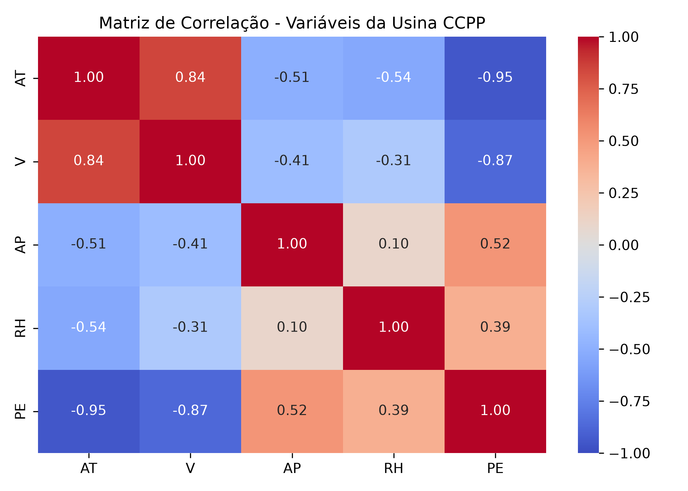
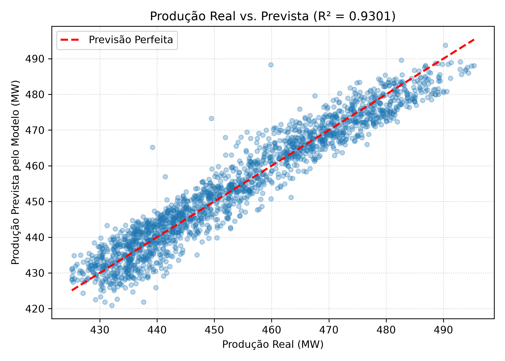
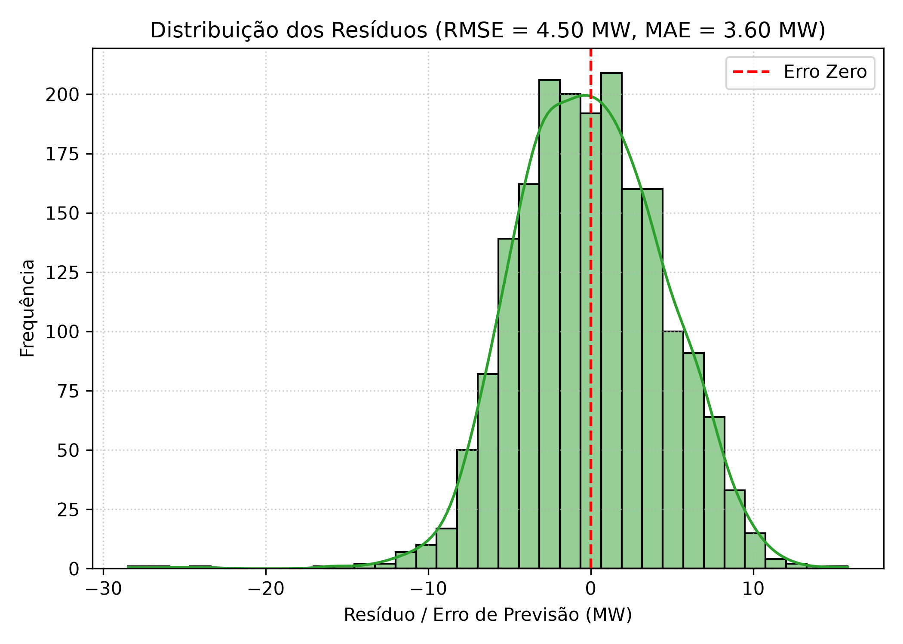

# Relatório - Problema 1: Regressão Linear para Previsão de Energia em Usina de Ciclo Combinado

**Disciplina:** PAM0466 – Sistemas Inteligentes  
**Semestre:** 2026.2  
**Docente:** Pedro Thiago Valério de Souza  
**Dataset:** UCI Combined Cycle Power Plant (CCPP) — 9.568 amostras  

---

## 1. Descrição do Problema e Pré-processamento

Uma Usina Termoelétrica de Ciclo Combinado (UTCC) integra duas tecnologias de geração elétrica: turbinas a gás (Ciclo Brayton) e turbinas a vapor (Ciclo Rankine). A produção líquida horária de energia ($PE$, em MW) varia sensivelmente com as condições meteorológicas e operacionais do sistema.

### Etapas de Pré-processamento realizadas:
- **Verificação de valores ausentes:** O conjunto contém 9.568 registros sem nenhum dado faltante ou nulo.
- **Divisão treino/teste:** 80% para treinamento (7.654 amostras) e 20% para teste (1.914 amostras), com semente fixa (`random_state=42`) para reprodutibilidade.
- **Padronização das variáveis preditoras:** Aplicação do $Z\text{-score}$ ($x' = \frac{x - \mu}{\sigma}$) ajustado exclusivamente sobre os dados de treino para evitar vazamento de dados (*data leakage*). A padronização foi adotada para colocar as variáveis em escalas comparáveis (temperatura em °C, pressão em mbar, vácuo em cm Hg, umidade em %).

---

## 2. Análise das Tarefas Solicitadas

### Tarefa 1: Correlação entre variáveis independentes e a variável dependente (PE)

| Variável | Descrição | Coeficiente de Pearson ($r$) com PE |
| :--- | :--- | :---: |
| **AT** | Temperatura Ambiente (°C) | **-0.9481** |
| **V** | Vácuo de Escape da Turbina (cm Hg) | **-0.8698** |
| **AP** | Pressão Atmosférica (mbar) | **+0.5184** |
| **RH** | Umidade Relativa (%) | **+0.3898** |

**Análise:**  
A variável de maior influência na produção de energia é a **Temperatura Ambiente (AT)**, com correlação linear negativa muito forte ($r = -0.9481$). Fisicamente, quanto maior a temperatura ambiente, menor é a densidade do ar que entra no compressor da turbina a gás, o que reduz a vazão mássica e derruba o rendimento termodinâmico do ciclo Brayton.  
Em segundo lugar, o **Vácuo de Escape (V)** apresenta forte correlação negativa ($r = -0.8698$), pois um vácuo menor (pressão de condensação mais elevada) reduz a queda de entalpia aproveitada pela turbina a vapor no ciclo Rankine. A pressão atmosférica (AP) e a umidade relativa (RH) exercem influência secundária e positiva.

---

### Tarefa 2: Correlação entre variáveis independentes e Multicolinearidade

Matriz de correlação entre os atributos de entrada:

| | AT | V | AP | RH |
| :---: | :---: | :---: | :---: | :---: |
| **AT** | 1.0000 | **0.8441** | -0.5075 | -0.5425 |
| **V** | **0.8441** | 1.0000 | -0.4135 | -0.3122 |
| **AP** | -0.5075 | -0.4135 | 1.0000 | 0.0996 |
| **RH** | -0.5425 | -0.3122 | 0.0996 | 1.0000 |

**Análise:**  
Existe uma relação linear muito forte e positiva entre **AT (Temperatura)** e **V (Vácuo de Escape)** ($r = 0.8441$).  
Isso indica a presença de **multicolinearidade**. Na prática, a temperatura ambiente dita em grande parte as condições do condensador da usina: dias mais quentes aumentam a temperatura da água de arrefecimento, elevando a pressão do condensador e o vácuo de escape. Embora a multicolinearidade não reduza o poder preditivo global do modelo ($R^2$), ela inflaciona a variância das estimativas dos coeficientes individuais, dificultando o isolamento do efeito causal estrito de cada variável separadamente.

---

### Tarefa 3: Construção do Modelo de Regressão Linear Múltipla

O modelo foi ajustado aos 80% de treino. Convertendo os parâmetros para a escala física original das variáveis, a equação ajustada é:

$$\text{PE} = 454.5691 - 1.9859 \cdot \text{AT} - 0.2321 \cdot \text{V} + 0.0622 \cdot \text{AP} - 0.1581 \cdot \text{RH}$$

- **AT:** Para cada aumento de 1 °C na temperatura ambiente, a usina perde em média $1.986\text{ MW}$ de potência, mantendo as demais variáveis constantes.
- **V:** Para cada aumento de 1 cm Hg no vácuo de escape, há redução de $0.232\text{ MW}$.
- **AP:** Aumentos de pressão atmosférica aumentam ligeiramente a produção ($+0.062\text{ MW/mbar}$).
- **RH:** O aumento da umidade relativa gera um leve decréscimo adicional quando controlado pela temperatura.

---

### Tarefa 4: Avaliação do Desempenho no Conjunto de Teste (20%)

Métricas obtidas sobre as 1.914 amostras de teste:

- **$R^2$ (Coeficiente de Determinação):** **0.9301** ($93.01\%$)
- **RMSE (Raiz do Erro Quadrático Médio):** **4.5026 MW**
- **MAE (Erro Absoluto Médio):** **3.5959 MW**

**O modelo é adequado para prever a produção de energia?**  
**Sim, o modelo é altamente adequado.**  
1. **Poder explicativo elevado:** O $R^2$ de $93.01\%$ demonstra que mais de $93\%$ da variabilidade da potência líquida gerada é explicada exclusivamente por essas quatro variáveis ambientais.
2. **Erro percentual reduzido:** A faixa de operação da usina no dataset varia entre $420.26\text{ MW}$ e $495.76\text{ MW}$ (amplitude de $\approx 75.5\text{ MW}$, média de $454.36\text{ MW}$). Um erro médio absoluto de $3.59\text{ MW}$ representa um erro relativo de apenas **$0.79\%$** em relação à média, margem plenamente aceitável e aplicável para o despacho econômico e planejamento do Operador Nacional do Sistema (ONS).
3. **Comportamento dos resíduos:** O gráfico de resíduos apresenta distribuição simétrica em torno de zero, sem assimetrias graves ou desvios sistemáticos, confirmando a validade das premissas do modelo linear.
