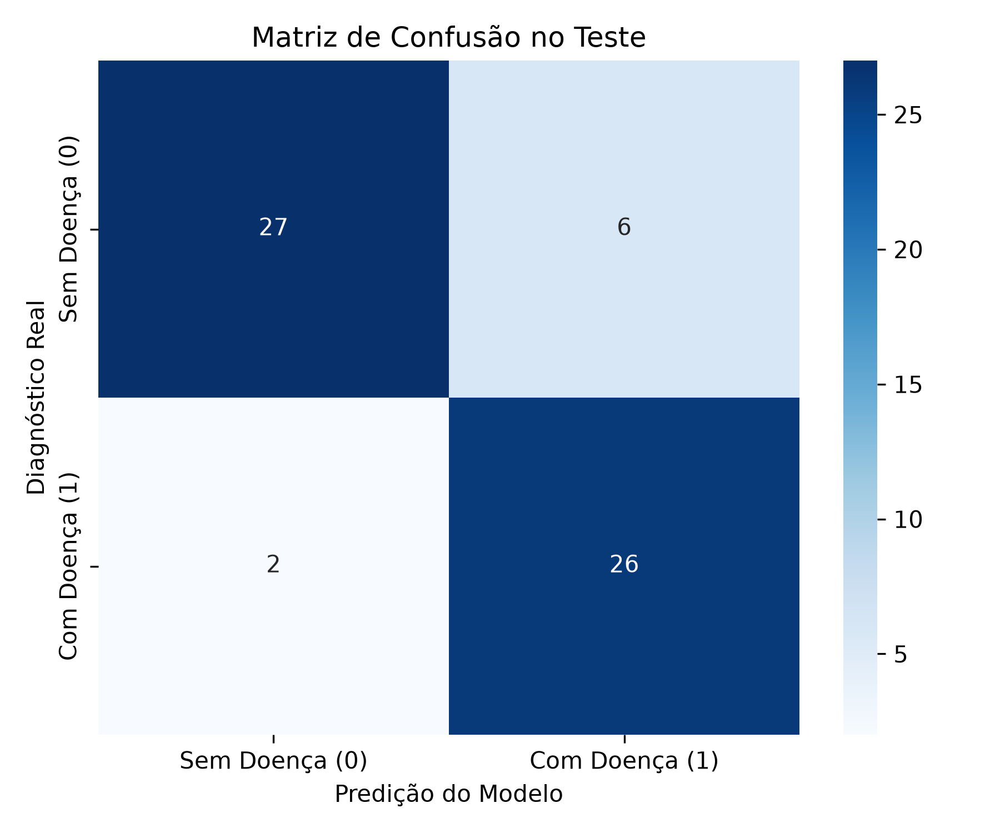
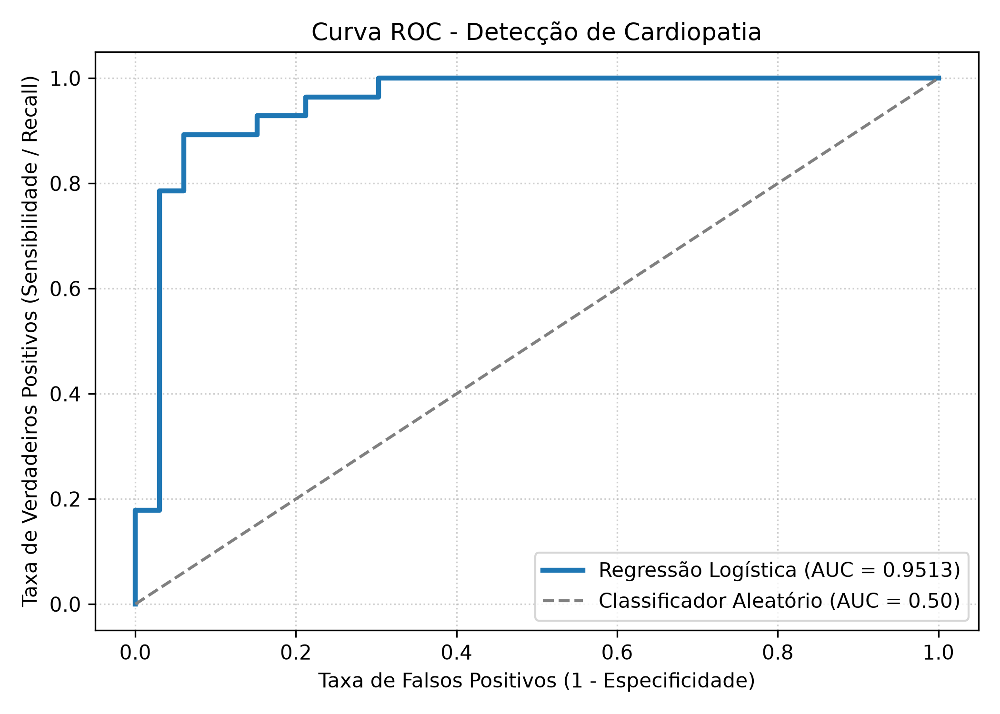

# Relatório - Problema 2: Regressão Logística para Previsão de Doenças Cardíacas

**Disciplina:** PAM0466 – Sistemas Inteligentes  
**Semestre:** 2026.2  
**Docente:** Pedro Thiago Valério de Souza  
**Dataset:** Heart Disease Cleveland (UCI) — 303 pacientes e 13 variáveis clínicas  

---

## 1. Descrição do Problema e Pré-processamento

Doenças cardiovasculares representam a principal causa de mortalidade global. O objetivo deste projeto é estimar o risco de presença de cardiopatia a partir de 13 variáveis clínicas coletadas em exames de rotina, validadas historicamente por cateterismo cardíaco.

### Etapas de Pré-processamento:
1. **Identificação e Tratamento de Dados Ausentes:**  
   As variáveis `ca` (artérias obstruídas) e `thal` (cintilografia de tálio) apresentavam, respectivamente, 4 e 2 valores ausentes identificados pelo caractere `'?'`. Foi realizada a imputação pela mediana de cada atributo, preservando o total de 303 observações sem introduzir distorções extremas.
2. **Binarização da Variável Alvo (`target`):**  
   O diagnóstico original variava de 0 (ausência de doença) a 4 (níveis crescentes de gravidade). Seguindo a especificação, os rótulos foram binarizados:
   - Classe 0: **Sem doença** (164 pacientes, $54.1\%$)
   - Classe 1: **Com doença cardíaca** (139 pacientes, $45.9\%$)
3. **Divisão Treino/Teste:**  
   Divisão de 80% para treino (242 pacientes) e 20% para teste (61 pacientes) com divisão estratificada (`stratify=y`) e semente fixa (`random_state=42`) para assegurar a mesma proporção de doentes em ambos os conjuntos.
4. **Padronização:**  
   As variáveis numéricas foram padronizadas via $Z\text{-score}$ com `StandardScaler` ajustado unicamente sobre o treino. Na Regressão Logística, a padronização evita que atributos de magnitude elevada (como colesterol sérico em torno de $250\text{ mg/dl}$) dominem o gradiente e a penalização em relação a atributos binários (como sexo ou glicemia).

---

## 2. Análise das Tarefas Solicitadas

### Tarefa 1: Treinamento e Convergência do Modelo

O classificador foi instanciado com os hiperparâmetros fixados:
- `solver='liblinear'`
- `random_state=42`
- `max_iter=1000`

**Resultado de Convergência:**  
O modelo atingiu a convergência em exatamente **5 iterações**.

**Justificativa Técnica:**  
O algoritmo `liblinear` utiliza descida de coordenadas (*Coordinate Descent*), resolvendo subproblemas unidimensionais sucessivos. Por se tratar de uma base com tamanho reduzido ($N = 242$ no treino) e atributos bem condicionados após a padronização, a função de perda logarítmica (*log-loss*) atinge o critério de tolerância de parada rapidamente, sem necessidade de se aproximar do limite de 1000 iterações.

---

### Tarefa 2: Avaliação no Conjunto de Teste (20%)

Métricas calculadas sobre os 61 pacientes de teste:

| Métrica | Valor Obtido |
| :--- | :---: |
| **Acurácia** | **0.8689** ($86.89\%$) |
| **Precisão** | **0.8125** ($81.25\%$) |
| **Recall (Sensibilidade)** | **0.9286** ($92.86\%$) |
| **F1-Score** | **0.8667** ($86.67\%$) |
| **AUC (Área sob a Curva ROC)** | **0.9513** |

#### Discussão Clínica e Metodológica:
1. **Relevância do Recall ($92.86\%$):**  
   Em diagnóstico médico, o custo de um **Falso Negativo** (dar alta a um cardiopata grave dizendo que ele está saudável) é incomensuravelmente maior do que o custo de um **Falso Positivo** (solicitar um exame confirmatório para um paciente saudável). O modelo identificou corretamente 26 dos 28 pacientes cardiopatas do conjunto de teste, gerando apenas 2 falsos negativos.
2. **Interpretação da Curva ROC e AUC ($0.9513$):**  
   O valor de $\text{AUC} = 0.9513$ comprova excelente capacidade discriminativa. Em termos práticos, se escolhermos aleatoriamente um paciente com doença e outro sem doença, há uma probabilidade de $95.13\%$ de o modelo atribuir uma probabilidade de risco mais alta ao paciente de fato doente.
3. **Fatores de Risco Mais Determinantes:**  
   Os coeficientes da regressão logística destacam que o número de vasos obstruídos (`ca`, $+1.1085$), o defeito no tálio (`thal`, $+0.6784$) e o sexo masculino (`sex`, $+0.6557$) são os maiores fatores de risco. Em contrapartida, a frequência cardíaca máxima alcançada no teste de esforço (`thalach`, $-0.3484$) atua como fator de proteção, condizente com a literatura cardiológica.
