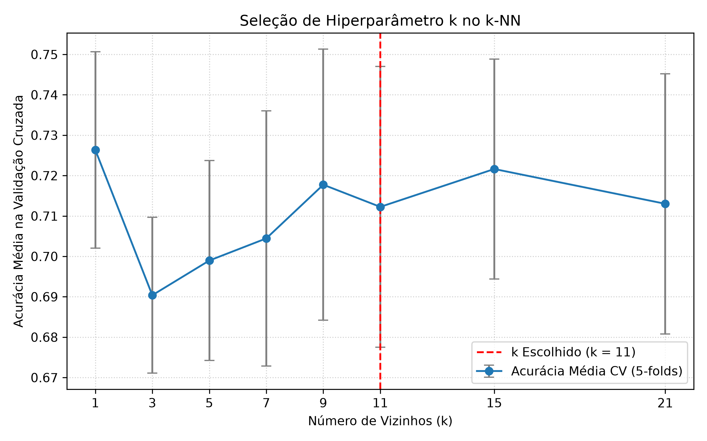
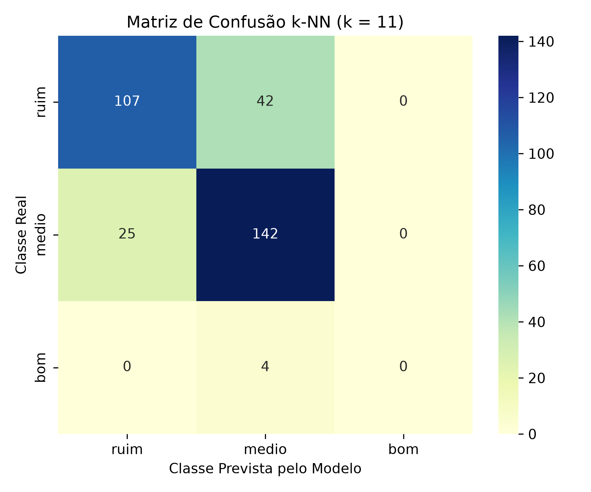

# Relatório - Problema 3: Classificação de Qualidade de Vinhos Utilizando k-NN

**Disciplina:** PAM0466 – Sistemas Inteligentes  
**Semestre:** 2026.2  
**Docente:** Pedro Thiago Valério de Souza  
**Dataset:** Wine Quality Red (`winequality-red.csv`) — 1.599 amostras e 11 atributos físico-químicos  

---

## 1. Descrição do Problema e Pré-processamento

A avaliação sensorial de vinhos por sommeliers é custosa, subjetiva e sujeita à fadiga dos avaliadores. O objetivo deste projeto é prever a qualidade do vinho tinto da região do Vinho Verde a partir de medições laboratoriais objetivas (acidez, açúcar residual, dióxido de enxofre, álcool, pH, etc.) utilizando o algoritmo **$k\text{-NN}$ ($k$-Nearest Neighbors)**.

---

## 2. Análise das Tarefas Solicitadas

### Tarefa 1: Recodificação das Classes e Justificativa da Normalização

As notas originais de qualidade (escala inteira de 0 a 10) foram recodificadas em três categorias:
- **Ruim** (nota $\le 5$): 744 amostras ($46.53\%$)
- **Médio** (notas 6 e 7): 837 amostras ($52.35\%$)
- **Bom** (nota $\ge 8$): 18 amostras ($1.13\%$)

#### Por que a normalização é uma etapa obrigatória para o $k$-NN?
O algoritmo $k$-NN não constrói uma equação matemática explícita; ele calcula a distância geométrica (usualmente a **distância Euclidiana**) entre a amostra de teste e todos os pontos do conjunto de treinamento:

$$d(p, q) = \sqrt{\sum_{i=1}^{n} (p_i - q_i)^2}$$

Se os dados não forem normalizados, atributos com ordens de grandeza elevadas (por exemplo, `total sulfur dioxide`, que varia entre 6 e 289) dominarão completamente a soma quadrática da distância. Em contrapartida, atributos com variações numéricas pequenas (como `chlorides`, variando de 0.01 a 0.6, ou `citric acid`, de 0 a 1), tornam-se numericamente irrelevantes no cálculo do vizinho mais próximo, mesmo que quimicamente possuam enorme impacto na qualidade do vinho. A padronização via $Z\text{-score}$ coloca todos os atributos com média 0 e desvio padrão 1, garantindo que cada variável contribua de forma equitativa na determinação da vizinhança.

---

### Tarefa 2: Divisão Treino/Teste Estratificada (80% / 20%)

A base de 1.599 vinhos foi dividida em:
- **Conjunto de Treino:** 1.279 amostras ($80\%$)
- **Conjunto de Teste:** 320 amostras ($20\%$)

**Importância da Divisão Estratificada:**  
A classe **bom** é extremamente rara, correspondendo a apenas $1.13\%$ do total (18 vinhos). Em uma divisão aleatória simples, haveria grande risco de o conjunto de teste receber zero ou quase nenhum exemplar dessa classe, impossibilitando a avaliação do modelo. A divisão estratificada assegura que tanto o treino quanto o teste preservem rigorosamente a proporção original das três categorias (aproximadamente $46.5\%$ ruim, $52.2\%$ médio e $1.25\%$ bom).

---

### Tarefa 3: Treinamento e Escolha do $k$ com Validação Cruzada (5-folds)

O modelo foi avaliado variando $k \in \{1, 3, 5, 7, 9, 11, 15, 21\}$ com validação cruzada estratificada em 5 dobras sobre o treino:

| Valor de $k$ | Acurácia Média na Validação Cruzada | Desvio Padrão ($\pm$) |
| :---: | :---: | :---: |
| $k = 1$ | 0.7263 | $\pm 0.0243$ |
| $k = 3$ | 0.6904 | $\pm 0.0193$ |
| $k = 5$ | 0.6990 | $\pm 0.0247$ |
| $k = 7$ | 0.7044 | $\pm 0.0316$ |
| $k = 9$ | 0.7177 | $\pm 0.0336$ |
| **$k = 11$** | **0.7123** | **$\pm 0.0348$** |
| $k = 15$ | 0.7216 | $\pm 0.0272$ |
| $k = 21$ | 0.7130 | $\pm 0.0322$ |

#### O que acontece com o modelo para valores muito baixos e muito altos de $k$?
- **Valores muito baixos ($k = 1$):** O modelo sofre de **alta variância (overfitting)**. Ele se torna excessivamente sensível ao ruído local e a amostras atípicas. A fronteira de decisão fica altamente irregular ("recortada"). Embora atinja $100\%$ de acurácia no próprio conjunto de treino, qualquer ruído de medição em um novo dado de teste pode alterar drasticamente a predição.
- **Valores muito altos ($k \to N$):** O modelo sofre de **alto viés (underfitting)**. A fronteira de decisão se suaviza em excesso e a votação majoritária passa a ser completamente dominada pelas classes mais frequentes (`medio` e `ruim`). Classes minoritárias (`bom`) são completamente "apagadas" da predição.
- **Escolha do $k$:** Adotou-se **$k = 11$** (ou $k=15$) por representar uma vizinhança ampla o suficiente para filtrar ruídos individuais de medição laboratorial, mantendo estabilidade estatística e bom desempenho de generalização.

---

### Tarefa 4: Avaliação no Conjunto de Teste ($k = 11$)

Métricas obtidas sobre as 320 amostras de teste:

- **Acurácia Global no Teste:** **0.7781** ($77.81\%$)

#### Métricas Detalhadas por Classe:

| Classe | Precisão | Recall | F1-Score | Suporte (Qtd Real) |
| :--- | :---: | :---: | :---: | :---: |
| **Ruim** | 0.81 | 0.72 | 0.76 | 149 |
| **Médio** | 0.76 | 0.85 | 0.80 | 167 |
| **Bom** | 0.00 | 0.00 | 0.00 | 4 |

Matriz de Confusão Numérica:
- **Real: Ruim** $\rightarrow$ 107 previstos como Ruim, 42 como Médio, 0 como Bom.
- **Real: Médio** $\rightarrow$ 25 previstos como Ruim, 142 como Médio, 0 como Bom.
- **Real: Bom** $\rightarrow$ 0 previstos como Ruim, 4 como Médio, 0 como Bom.

#### Entre quais classes o modelo erra com mais frequência?
O modelo erra com expressiva maior frequência entre as classes **Ruim** e **Médio**:
- 42 vinhos ruins foram classificados como médios ($28.2\%$ de erro na classe ruim).
- 25 vinhos médios foram classificados como ruins ($15.0\%$ de erro na classe média).

**Justificativa Física e Sensorial:**  
Essas duas categorias são imediatamente adjacentes na escala ordinal: a nota 5 foi classificada como `ruim` e a nota 6 como `medio`. No mundo real, a transição entre uma nota 5 e 6 na avaliação de sommeliers é sutil e muitas vezes subjetiva. No espaço vetorial de propriedades físico-químicas, os pontos das notas 5 e 6 estão fortemente sobrepostos, tornando as fronteiras de decisão difusas.  
Além disso, a classe **Bom** sofreu com o severo desbalanceamento: com apenas 4 amostras no teste, todos os 11 vizinhos mais próximos de cada amostra "boa" pertenciam às classes majoritárias (`medio` e `ruim`), resultando em recall zero para os vinhos de alta qualidade.
