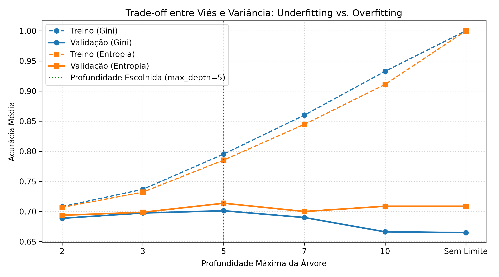
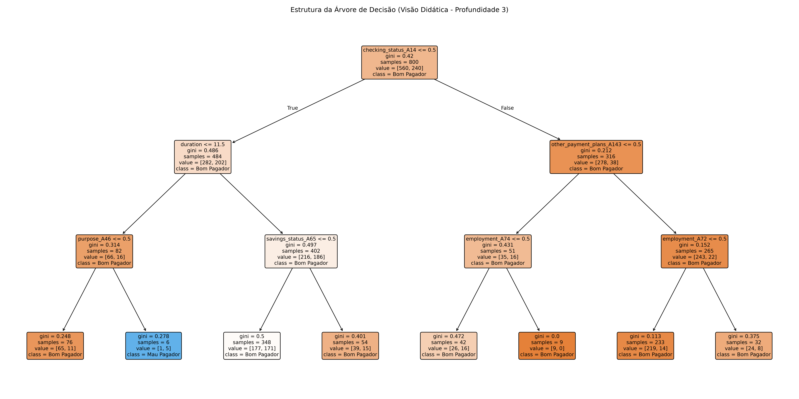
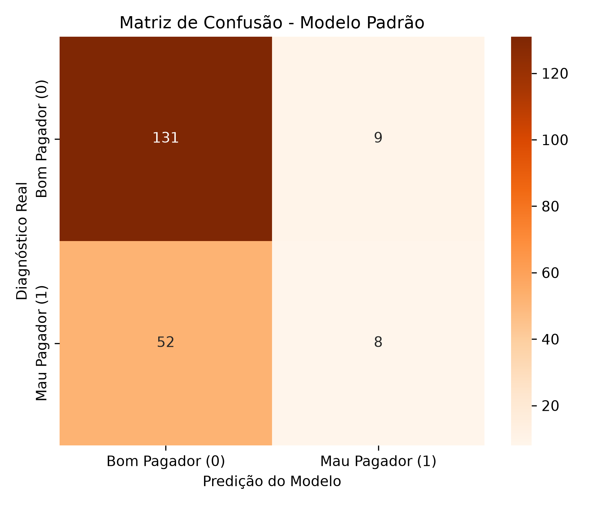

# Relatório - Problema 4: Classificação de Risco de Crédito Utilizando Árvores de Decisão

**Disciplina:** PAM0466 – Sistemas Inteligentes  
**Semestre:** 2026.2  
**Docente:** Pedro Thiago Valério de Souza  
**Dataset:** Statlog German Credit Data — 1.000 amostras e 20 atributos  

---

## 1. Descrição do Problema e Contexto Regulatório

A concessão de crédito exige modelos transparentes e auditáveis. Conforme o Artigo 20 da LGPD (Lei 13.709/2018), todo cidadão tem o direito de solicitar a revisão e a explicação de decisões tomadas unicamente por sistemas automatizados. As Árvores de Decisão (*Decision Trees*) destacam-se nesse cenário por sua interpretabilidade nativa (*white-box model*), permitindo extrair regras do tipo "SE-ENTÃO" compreensíveis por analistas e clientes.

---

## 2. Análise das Tarefas Solicitadas

### Tarefa 1: Identificação de Atributos, Codificação e Desbalanceamento

- **Atributos Numéricos (7):** `duration`, `credit_amount`, `installment_commitment`, `residence_since`, `age`, `existing_credits`, `num_dependents`.
- **Atributos Categóricos (13):** `checking_status`, `credit_history`, `purpose`, `savings_status`, `employment`, `personal_status`, `other_parties`, `property_magnitude`, `other_payment_plans`, `housing`, `job`, `own_telephone`, `foreign_worker`.

#### Necessidade de Codificação:
Árvores no *scikit-learn* exigem matrizes numéricas. Para variáveis nominais sem relação intrínseca de ordem (como o propósito do empréstimo: rádio/TV, carro novo, educação; ou moradia: própria, alugada), utilizou-se o **One-Hot Encoding**. O uso de *Ordinal Encoding* criaria uma falsa hierarquia numérica inexistente (ex: atribuir 1 para aluguel e 2 para moradia própria forçaria a árvore a considerar que moradia própria é "o dobro" de aluguel).

#### Impacto do Desbalanceamento (70% Bom / 30% Mau) sobre a Acurácia:
A base possui 700 bons pagadores ($70\%$) e 300 maus pagadores ($30\%$).  
Em cenários desbalanceados, a **acurácia torna-se uma métrica perigosa** (conhecido como *paradoxo da acurácia*). Um classificador simplório ou preguiçoso que simplesmente previsse *"bom pagador"* para 100% dos clientes teria uma acurácia aparente de **$70\%$**, sem jamais ter aprendido padrão algum. Na prática bancária, esse modelo aprovaria 100% dos inadimplentes, gerando perdas financeiras severas.

---

### Tarefa 2: Por que a Normalização não é Necessária para Árvores de Decisão?

Ao contrário de modelos lineares (como Regressão Logística) ou baseados em distâncias ($k$-NN e $k$-Means), as Árvores de Decisão operam particionando um único atributo por vez por meio de comparações de desigualdade ($x_j \le c$).  
O critério de divisão (seja Gini ou Entropia) depende exclusivamente da **ordem relativa** dos dados e da pureza das classes em cada lado da partição. Como qualquer transformação monotônica crescente (como $Z\text{-score}$, Min-Max ou log) preserva estritamente a ordenação dos pontos, o limiar ótimo de corte $c$ mapeia-se de forma idêntica e a estrutura da árvore permanece rigorosamente a mesma. Portanto, normalizar é completamente dispensável.

---

### Tarefa 3: Divisão Treino/Teste Estratificada (80% / 20%)

A divisão foi realizada com $80\%$ para treino (800 amostras) e $20\%$ para teste (200 amostras), com `stratify=y` e `random_state=42`, garantindo exatamente 140 bons pagadores e 60 maus pagadores no conjunto de teste.

---

### Tarefa 4: Treinamento e Controle de Complexidade (Profundidade Máxima e Critério)

Avaliou-se a profundidade máxima com validação cruzada estratificada em 5 dobras (*5-fold CV*):

| Profundidade | Gini Treino | Gini Validação | Entropia Treino | Entropia Validação |
| :---: | :---: | :---: | :---: | :---: |
| **2** | 0.7081 | 0.6888 | 0.7069 | 0.6937 |
| **3** | 0.7369 | 0.6975 | 0.7322 | 0.6987 |
| **5 (Ótimo)** | **0.7953** | **0.7013** | **0.7853** | **0.7137** |
| **7** | 0.8600 | 0.6900 | 0.8447 | 0.7000 |
| **10** | 0.9328 | 0.6663 | 0.9109 | 0.7087 |
| **Sem Limite** | **1.0000** | **0.6650** | **1.0000** | **0.7087** |

#### Análise de Underfitting vs. Overfitting:
- **Profundidades muito baixas ($\le 2$):** Ocorreu **Underfitting (alto viés)**. A árvore é excessivamente simples (poucas divisões) e incapaz de capturar a interação entre as variáveis financeiras.
- **Profundidades muito altas ($\ge 10$ ou Sem Limite):** Ocorreu **Overfitting (alta variância)**. A árvore decora os dados de treino, atingindo acurácia perfeita de **$100\%$** no treino, mas sua acurácia na validação cai para cerca de $66.5\%$. A árvore aprendeu ruídos amostrais que não generalizam.
- **Comparação Gini vs. Entropia:** O critério de Entropia obteve acurácia ligeiramente superior na validação na profundidade 5 ($71.37\%$ contra $70.13\%$ do Gini), mas ambos exibiram comportamento similar ao longo das profundidades. Adotou-se **profundidade 5** como o equilíbrio ideal.

---

### Tarefa 5: Interpretação do Modelo e Extração de Regras

#### Top 3 Atributos Mais Determinantes:
1. **`checking_status` (Status da Conta Corrente):** $29.5\%$ de importância. Em particular, a ausência de conta corrente deficitária (`A14`) é o maior discriminador.
2. **`credit_amount` (Valor do Empréstimo):** $21.8\%$ de importância. Empréstimos de valores mais altos elevam exponencialmente o risco.
3. **`duration` (Duração do Contrato):** $8.5\%$ de importância. Prazos mais longos expõem o banco a maiores incertezas temporais.

#### Regra em Linguagem Natural da Folha com Maior Concentração de Mau Risco (Folha 19):
> **SE** o cliente possui conta corrente ativa no banco com saldo modesto ou devedor (`checking_status_A14 <= 0.50`)  
> **E** o prazo do empréstimo for longo, superior a 11.5 meses (`duration > 11.50`)  
> **E** o cliente não possuir reservas substanciais em conta poupança (`savings_status_A65 <= 0.50`)  
> **E** o valor de crédito solicitado for elevado, acima de 8.015 marcos (`credit_amount > 8015.50`)  
> **E** a qualificação profissional não for de nível gerencial pleno (`job_A172 <= 0.50`)  
> **ENTÃO** classifique o solicitante como **MAU PAGADOR** (nesta folha, a taxa de inadimplência observada foi de **88.0%** — 22 inadimplentes em 25 clientes).

---

### Tarefa 6: Avaliação no Conjunto de Teste e Proposta de Ajuste

Métricas obtidas com o modelo padrão no teste (200 solicitantes):

- **Acurácia Global:** **$69.50\%$**
- **Bons Pagadores:** Precisão = $72\%$, Recall = $94\%$, F1 = $0.81$
- **Maus Pagadores:** Precisão = $47\%$, Recall = $13\%$, F1 = $0.21$

#### Qual tipo de erro o modelo comete com mais frequência e por que é o mais grave?
O modelo comete predominantemente o erro de classificar **Maus Pagadores como Bons Pagadores** (Falso Negativo para inadimplência): foram **52 casos** de inadimplentes aprovados erroneamente, contra apenas **9 casos** de bons pagadores rejeitados.  
Esse erro é **o mais grave e danoso**: emprestar dinheiro a quem não paga acarreta perda direta do capital principal e custos judiciais de recuperação. Já rejeitar um bom cliente acarreta apenas o custo de oportunidade (perda do spread de juros daquela operação).

#### Ajuste no Treinamento para Reduzir o Erro Grave:
Aplicou-se o balanceamento de penalidades via **`class_weight='balanced'`**, que pondera inversamente os erros de acordo com a frequência das classes.
- Os maus pagadores aprovados erroneamente despencaram de **52 para apenas 17**!
- O Recall da classe de maus pagadores saltou de **$13\%$ para $72\%$**, blindando a instituição contra a grande maioria dos calotes.
