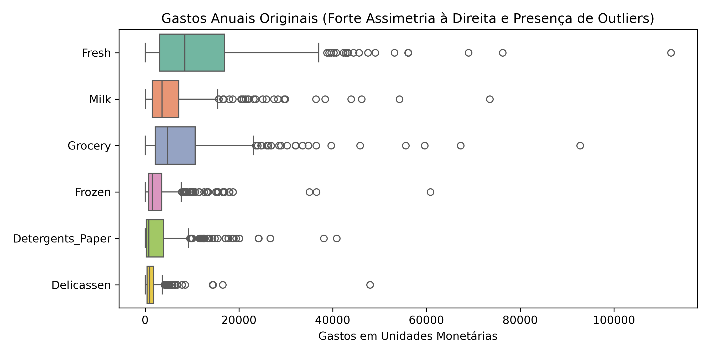
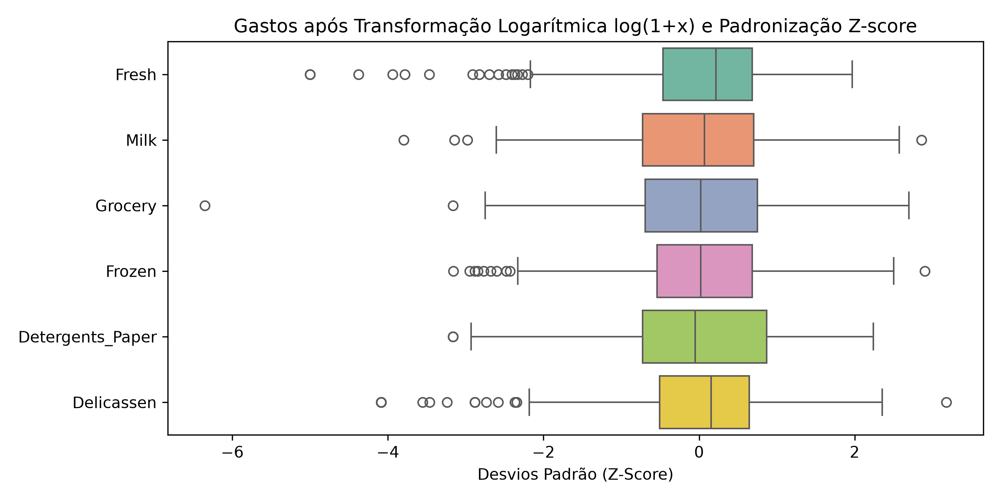
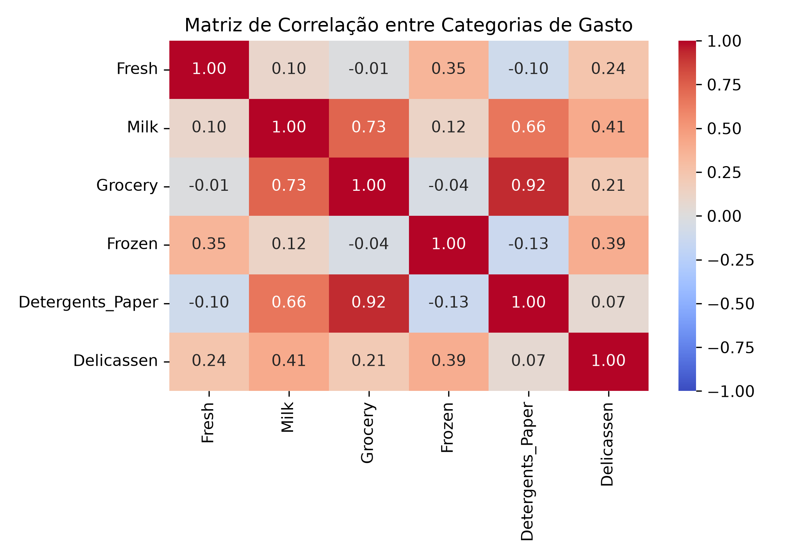
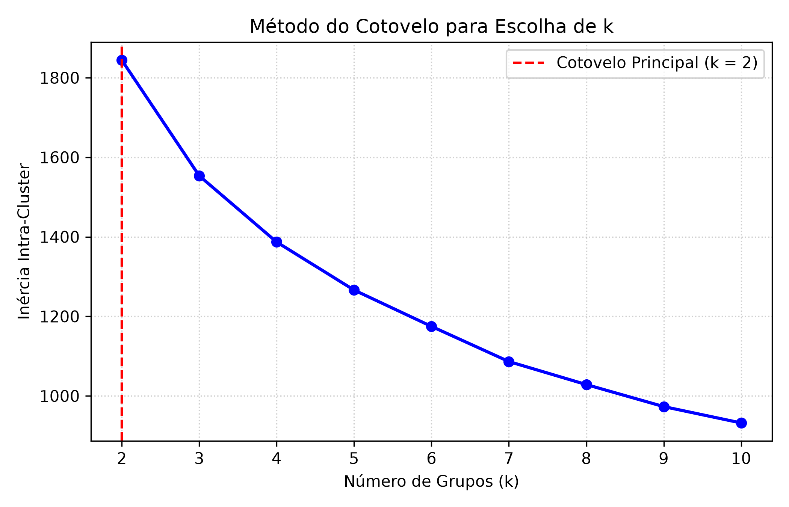
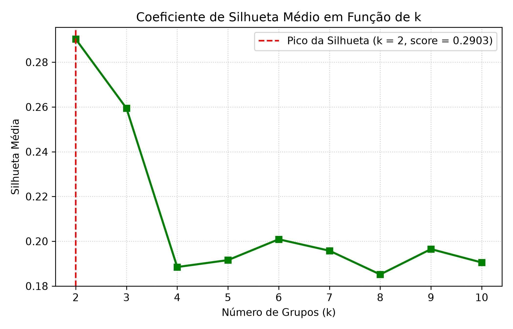
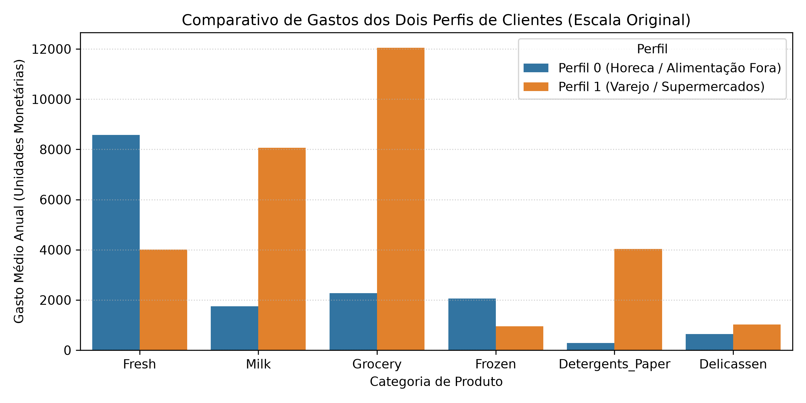
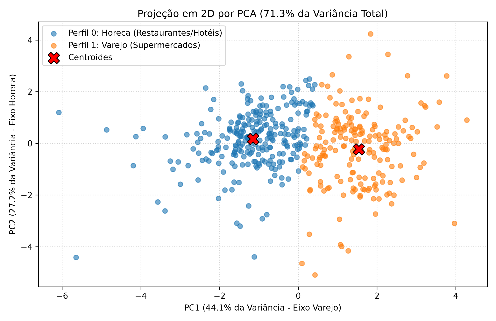

# Relatório - Problema 5: Segmentação de Clientes Utilizando k-Means

**Disciplina:** PAM0466 – Sistemas Inteligentes  
**Semestre:** 2026.2  
**Docente:** Pedro Thiago Valério de Souza  
**Dataset:** Wholesale Customers Dataset — 440 clientes e 6 categorias de gastos  

---

## 1. Descrição do Problema e Aprendizado Não Supervisionado

Diferentemente dos problemas anteriores, a segmentação de clientes é um problema de **aprendizado não supervisionado**: não existem rótulos prévios de "bom cliente", "restaurante" ou "varejo". Os grupos devem emergir naturalmente da estrutura matemática dos gastos anuais em seis categorias: `Fresh` (frescos), `Milk` (laticínios), `Grocery` (mercearia), `Frozen` (congelados), `Detergents_Paper` (detergentes e papel) e `Delicassen`.  
Os atributos `Channel` (canal de venda) e `Region` (região geográfica) foram reservados exclusivamente para a validação externa.

---

## 2. Análise das Tarefas Solicitadas

### Tarefa 1: Preparação dos Dados, Assimetria e Padronização

#### Estatísticas Descritivas dos Gastos Anuais (Unidades Monetárias):

| Categoria | Média | Mediana | Desvio Padrão | Mínimo | Máximo |
| :--- | :---: | :---: | :---: | :---: | :---: |
| **Fresh** | 12.000,3 | 8.504,0 | 12.647,3 | 3 | 112.151 |
| **Milk** | 5.796,3 | 3.627,0 | 7.380,4 | 55 | 73.498 |
| **Grocery** | 7.951,3 | 4.755,5 | 9.503,2 | 3 | 92.780 |
| **Frozen** | 3.071,9 | 1.526,0 | 4.854,7 | 25 | 60.869 |
| **Detergents_Paper** | 2.881,5 | 816,5 | 4.767,9 | 3 | 40.827 |
| **Delicassen** | 1.524,9 | 965,5 | 2.820,1 | 3 | 47.943 |

Em todas as categorias, a média é substancialmente maior que a mediana e os valores máximos chegam a dezenas de vezes a média, evidenciando **distribuições fortemente assimétricas à direita** com presença de grandes compradores (*outliers* comerciais).

#### Justificativas Metodológicas:
- **(a) Por que a transformação logarítmica $x' = \log(1 + x)$ é recomendável?**  
  A transformação logarítmica "encolhe" as caudas longas da distribuição, aproximando os dados de um comportamento normal e reduzindo o impacto desproporcional de compradores gigantescos. Além disso, no comércio atacadista, variações de gastos comportam-se de forma multiplicativa (ordens de grandeza) e não puramente aditiva.
- **(b) Por que a padronização $Z\text{-score}$ é determinante para o $k$-Means?**  
  O $k$-Means utiliza a **distância Euclidiana** para atribuir clientes ao centroide mais próximo ($d(x, \mu) = \sqrt{\sum (x_j - \mu_j)^2}$). Se os dados não forem padronizados, a categoria `Fresh` (média 12.000) exerceria uma influência quadrática esmagadora sobre o cálculo da distância em relação a `Delicassen` (média 1.500), fazendo com que o algoritmo agrupasse clientes quase que exclusivamente com base em hortifrúti.

#### Matriz de Correlação e o Par `Grocery` – `Detergents_Paper`:
A correlação linear entre `Grocery` e `Detergents_Paper` é de **$+0.9246$** (altíssima correlação positiva).  
**Comentário Comercial:** Quem compra itens de mercearia no atacado (alimentos não perecíveis embalados) quase que invariavelmente abastece suas prateleiras com produtos de limpeza doméstica e papel. Trata-se do padrão típico de compras de **supermercados e mercearias de varejo**, distinguindo-os claramente de estabelecimentos de alimentação pronta (restaurantes).

---

### Tarefa 2: Ausência de Divisão Treino/Teste e o Dilema da Validação em Clusterização

- **Contraste com Aprendizado Supervisionado:**  
  No aprendizado supervisionado, o objetivo central é prever um rótulo $y$ pré-existente e minimizar o erro de generalização sobre dados nunca vistos, exigindo um conjunto de teste isolado como garantia contra memorização (*overfitting*).  
  No agrupamento (não supervisionado), o objetivo é **descobrir padrões latentes e resumir a estrutura intrínseca** de todo o conjunto de clientes. Separar um conjunto de teste não faz sentido, pois não existe um gabarito a ser predito.
- **Dificuldade Central da Validação:**  
  Não existe uma função de perda universalmente "certa" ou rótulo verdadeiro. Métricas internas (como inércia e silhueta) avaliam apenas a geometria dos pontos (se estão compactos e separados), mas não atestam se os grupos fazem sentido no mundo real. Uma partição só é verdadeiramente "boa" se for **comercialmente acionável** pela equipe de marketing e logística da distribuidora.

---

### Tarefa 3: Escolha do Número de Grupos ($k$)

Executou-se o algoritmo para $k \in [2, 10]$:

| $k$ | Inércia Intra-Cluster | Coeficiente de Silhueta Médio |
| :---: | :---: | :---: |
| **$k = 2$ (Ótimo)** | **1.844,06** | **0.2903 (Máximo Global)** |
| $k = 3$ | 1.553,42 | 0.2594 |
| $k = 4$ | 1.386,86 | 0.1885 |
| $k = 5$ | 1.266,15 | 0.1916 |
| $k = 6$ | 1.174,76 | 0.2009 |

#### Decisão de Escolha:
Adotou-se **$k = 2$**:
1. **Pico da Silhueta:** O valor $k=2$ atinge a maior silhueta média ($0.2903$).
2. **Método do Cotovelo:** A maior redução marginal de inércia ocorre entre $k=1$ e $k=2$.
3. **Interpretabilidade Comercial:** Divide a carteira nos dois modelos de negócio fundamentais do atacado: estabelecimentos de consumo imediato (food service) versus revendedores (varejo).

#### Por que a inércia decresce monotonicamente com $k$?
A inércia mede a soma das distâncias ao quadrado de cada ponto ao seu centroide mais próximo. Ao adicionar mais centroides, os pontos só podem permanecer à mesma distância ou encontrar um centroide ainda mais próximo; a distância média nunca aumenta.  
**Caso Limite ($k = N$):** Se colocarmos $k = 440$ (um centroide por cliente), a inércia será exatamente **ZERO**, pois cada cliente será seu próprio centroide. No entanto, esse agrupamento tem utilidade nula: não há síntese, abstração nem economia de escala para a operação.

---

### Tarefa 4: Inicialização e Convergência (`random` vs `k-means++`)

Executou-se o $k$-Means 10 vezes ($n\_init=1$) com sementes diferentes:
- `init='random'`: Média = $1.844,08$, Desvio Padrão = $0.0289$.
- `init='k-means++'`: Média = $1.844,09$, Desvio Padrão = $0.0308$.

**Problema mitigado pelo `k-means++`:**  
O $k$-Means tradicional pode convergir para mínimos locais ruins caso centroides iniciais sejam sorteados muito próximos entre si dentro de um mesmo agrupamento denso. O algoritmo `k-means++` resolve isso escolhendo o primeiro centroide aleatoriamente e cada centroide subsequente com probabilidade proporcional ao quadrado da distância ao centroide mais próximo já existente ($P(x) \propto D(x)^2$). Isso garante que os centros iniciais fiquem bem dispersos pelo espaço, acelerando a convergência e assegurando resultados estáveis.

---

### Tarefa 5: Interpretação e Validação Externa dos Grupos

#### Centroides Revertidos para a Escala Original (Gasto Médio Anual em Unidades Monetárias):

| Perfil Comercial | Fresh | Milk | Grocery | Frozen | Detergents_Paper | Delicassen |
| :--- | :---: | :---: | :---: | :---: | :---: | :---: |
| **Perfil 0: Horeca (Hotéis, Restaurantes e Cafés)** | **8.580,6** | 1.753,7 | 2.274,4 | **2.063,8** | 287,4 | 649,4 |
| **Perfil 1: Varejo (Supermercados e Mercearias)** | 4.013,9 | **8.061,6** | **12.051,1** | 953,5 | **4.035,6** | **1.022,1** |

#### Validação Externa com `Channel` e `Region`:
- **Cruzamento com `Channel`:**
  - **Cluster 0:** 244 clientes Horeca e apenas 8 clientes de Varejo ($96.8\%$ pureza em Horeca).
  - **Cluster 1:** 134 clientes de Varejo e 54 clientes Horeca ($71.3\%$ de Varejo).
  - **Índice Rand Ajustado (ARI):** **$0.5135$**. O algoritmo, sem jamais ter tido acesso à coluna `Channel`, foi capaz de reconstruir com alta fidelidade a estrutura do canal de venda a partir unicamente das notas fiscais de compra!
- **Categorias que mais separam os canais:** `Grocery` e `Detergents_Paper` (gastos até 14 vezes maiores no Varejo) em oposição a `Fresh` e `Frozen` (muito mais demandados por cozinhas profissionais).
- **A região geográfica se reflete nos agrupamentos?**  
  **Não.** A distribuição entre Lisboa ($17\%$), Porto ($11\%$) e Outras Regiões ($72\%$) é praticamente idêntica dentro do Cluster 0 e do Cluster 1. O perfil de compras independe da geografia.

#### Duas Limitações do $k$-Means Evidenciadas na Projeção PCA:
1. **Tendência a grupos esféricos e de tamanhos semelhantes:** O $k$-Means assume que os agrupamentos são esferas isotrópicas no espaço euclidiano com variâncias homogêneas. Quando existem correlações lineares fortes (como `Grocery` e `Detergents_Paper`, que formam feixes alongados/elípticos), o $k$-Means tende a "cortar" essas formas de maneira artificial.
2. **Sensibilidade a Outliers:** Por minimizar a soma de quadrados das distâncias, clientes com volumes de compra extraordinários puxam os centroides fortemente em sua direção, distorcendo o posicionamento representativo da massa de clientes comuns.
